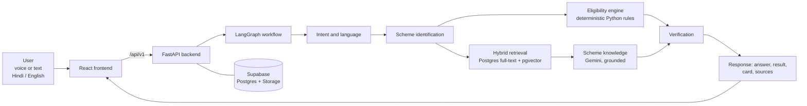

# 🌾 Yojana Mitra

**Your guide to government schemes: in your own language, by voice or text.**


Built by **Team TRIVON** for a 24-hour AI/ML hackathon (30-31 October 2026).

> Yojana Mitra talks with rural families in Hindi or English, asks the few questions an official scheme actually needs, tells them whether they are *likely eligible*, and hands over a card with what to carry and where to apply. Every answer is tied to an official document, and the eligibility decision is made by rules in code, never by the AI model.

---

## Contents

- [The problem](#the-problem)
- [Our solution](#our-solution)
- [What makes it different](#what-makes-it-different)
- [How it works](#how-it-works)
- [Current scope](#current-scope)
- [Tech stack](#tech-stack)
- [Project structure](#project-structure)
- [Getting started](#getting-started)
- [API overview](#api-overview)
- [Evaluation and trust](#evaluation-and-trust)
- [Privacy and responsible use](#privacy-and-responsible-use)
- [Project status](#project-status)
- [Team](#team)
- [Sources](#sources)

---

## The problem

Government schemes exist for the people who need them most, but finding out **whether you qualify, and what to carry**, is hard.

- **The information is written, scattered and technical.** Eligibility rules sit in English or formal Hindi documents across several portals. The official declaration for the Pradhan Mantri Ujjwala Yojana (PMUY) alone lists 13 deprivation criteria, using terms such as "irrigated land with irrigation equipment", "carpet area" and "Kisan Credit Card credit limit".
- **People already look for spoken help.** Rural India is online (488 million of India's 886 million internet users in 2024, per IAMAI-Kantar), and Kisan Call Centres registered about 17.5 million calls in roughly three years to mid-2021, according to a government statement.
- **A wrong or vague answer is costly.** Families commonly depend on intermediaries or repeat visits to offices and service centres to learn whether they qualify and which documents to bring. Generic chatbots can answer confidently without an official source.

Existing tools help: myScheme lists thousands of schemes with a text-based eligibility check, and government chatbots answer questions about specific schemes. Our focus is different: a **spoken, step-by-step eligibility conversation** that ends with a **checklist of what to carry**, built on **rules that cannot be overridden by an AI model**.

## Our solution

**Yojana Mitra** is a voice-first (and text) assistant for government scheme eligibility.

1. **Choose a language** (Hindi or English) and a mode: voice, chat or both.
2. **Ask a question**, for example "Am I eligible for the Ujjwala scheme?"
3. **Answer a few short questions.** The assistant asks only what the official rules need, one at a time, with "not sure" always allowed.
4. **Get a clear, honest result:** *likely eligible*, *likely not eligible* or *cannot determine yet*, with the reasons and what is missing.
5. **Leave with a take-away card:** documents to carry, where to apply, the official sources, and a reminder that the result is indicative, not an official decision.

*Illustrative example (not a real result):*

> **You (voice):** क्या मैं उज्ज्वला योजना के लिए पात्र हूँ? *(Am I eligible for the Ujjwala scheme?)*
> **Yojana Mitra:** क्या आपके घर में पहले से LPG कनेक्शन है? *(Does your household already have an LPG connection?)*
> *...a few more short questions...*
> **Result card:** likely eligible, documents to carry, where to apply, official sources, "confirm with your LPG distributor".

## What makes it different

| | Feature | Why it matters |
|---|---|---|
| 🗣️ | **Ask-back eligibility interview** | It interviews the user in simple spoken language instead of lecturing or asking them to fill a text form, and says exactly what information is missing. |
| ⚖️ | **Rules in code, not in the model** | Eligibility is decided by deterministic Python rules taken from official documents. The AI model explains the result but can never invent or override a rule. "Not sure" is never treated as "no". |
| 🧾 | **Take-away action card** | The user leaves with the documents to carry, where to apply, and the sources, which targets repeat trips and wrong paperwork. |
| 📚 | **Grounded answers, honest refusals** | Answers come only from retrieved official passages and show their source. When the documents do not cover a question, the assistant says so. |
| 🧭 | **Three separate answers, not one score** | We keep *eligibility*, *official verification* and *application readiness* apart, so a missing document never looks like ineligibility. |
| 🎙️ | **One conversation, voice or text** | Voice and text share the same session and the same logic. If speech fails, typing keeps working. |
| 🔒 | **Privacy by design** | We never ask for Aadhaar or bank account numbers in conversation, and we store no raw audio by default. |

*How we compare is based on our research of public descriptions as of 30 October 2026; we will verify it before any claim of "first" or "only".*

## How it works



- **Seven logical workflow nodes** run conditionally in LangGraph, so they do not mean seven model calls.
- **Gemini is used in three tiers** (high, mid, lite) by task complexity; exact model IDs live in environment variables.
- **Retrieval is hybrid:** PostgreSQL full-text search plus pgvector similarity, filtered by scheme, with page and source references.
- **Speech:** speech-to-text is chosen by benchmarking candidates on Hindi recordings; text-to-speech uses a lite-tier model. The written answer always remains available.

## Current scope

| Scheme | Status |
|---|---|
| **PMUY 2.0** (Pradhan Mantri Ujjwala Yojana) | Reference scheme. Official-source research complete; rule set and test cases frozen. |
| PM-KISAN | Planned. Needs its own official-source extraction and rule validation. |
| PM-JAY 70+ | Planned. Needs its own official-source extraction and rule validation. |

**Languages:** Hindi and English, selected manually by the user.
**Not in scope:** submitting applications, identity authentication, lookups of private records, medical or legal advice.

## Tech stack

| Layer | Technology |
|---|---|
| Frontend | React, TypeScript, Vite, Tailwind CSS |
| Backend | Python, FastAPI |
| Orchestration | LangGraph |
| LLM | Google Gemini (high / mid / lite tiers) |
| Eligibility | Deterministic Python rules |
| Database | Supabase PostgreSQL |
| Retrieval | PostgreSQL full-text search + pgvector |
| Documents | Supabase Storage |
| Hosting | Vercel (frontend), Render (backend) |
| Development | Git, GitHub, Antigravity |

## Project structure

```text
yojana-mitra/
├── frontend/        # React + TypeScript app: screens, voice/text interface, mocks
├── backend/         # FastAPI app: routes, schemas, LangGraph workflow, retrieval,
│   │                #   eligibility rules, database, speech and Gemini services
│   └── tests/
├── data/            # Official scheme documents, extracted text, scheme rules,
│                    #   evaluation questions and expected results
├── shared/          # API contract and canonical JSON examples
├── docs/            # Architecture reference and decision register
├── .env.example     # Variable names only, never real secrets
└── README.md
```

## Getting started

> The code is being written during the hackathon. These steps describe the agreed setup and will be confirmed as each part lands.

**Prerequisites:** Node.js (LTS), Python 3, a Supabase project, and a Gemini API key.

```bash
git clone https://github.com/ankush_poonia007/yojana-mitra.git
cd yojana-mitra
cp .env.example .env            # then add your own keys; never commit .env

# Backend
cd backend
python -m venv .venv && source .venv/bin/activate
pip install -r requirements.txt
uvicorn app.main:app --reload   # API docs at http://localhost:8000/docs

# Frontend (new terminal)
cd frontend
npm install
npm run dev
```

**Mock mode:** set `MOCK_MODE=true` (backend) and `VITE_MOCK_MODE=true` (frontend) to run with sample responses and no provider keys. Mock responses use the same schema as real ones and are labeled as sample data.

**Environment variables (names only):** `APP_ENV`, `APP_PORT`, `CORS_ORIGINS`, `GEMINI_API_KEY`, `GEMINI_MODEL_HIGH`, `GEMINI_MODEL_MID`, `GEMINI_MODEL_LITE`, `STT_PROVIDER`, `STT_API_KEY`, `STT_MODEL`, `TTS_PROVIDER`, `TTS_API_KEY`, `TTS_MODEL`, `SUPABASE_URL`, `SUPABASE_ANON_KEY`, `SUPABASE_SERVICE_ROLE_KEY`, `DATABASE_URL`, `MOCK_MODE`, `LOG_LEVEL`; frontend: `VITE_API_BASE_URL`, `VITE_MOCK_MODE`. The service-role key and provider keys must stay on the backend.

## API overview

Base path `/api/v1`. Text and voice share one conversation state and one response structure; errors use a single error envelope. Full contract in `shared/api-contract.md`.

| Endpoint | Method | Purpose |
|---|---|---|
| `/api/v1/sessions` | POST | Create a conversation session (language and mode) |
| `/api/v1/sessions/{session_id}` | GET | Retrieve a session and its turns |
| `/api/v1/turns` | POST | Submit a text turn |
| `/api/v1/voice/turns` | POST | Submit a voice turn (multipart audio) |

A completed turn returns the answer text, the assessment (`likely_eligible`, `likely_not_eligible` or `cannot_determine`, with reasons and missing information), the take-away card, source references and optional speech.

## Evaluation and trust

We are designing for measurable honesty rather than claims.

- **Rule tests:** twelve designed PMUY test cases (for example under-18 applicant, existing LPG connection, household member earning above the declared limit, unknown answers) check the deterministic rules.
- **Trust scorecard (planned):** a test set of questions built from the official documents, scored for correct answers, correct sources and correct refusals, plus card completeness against the official document list.
- **No results yet:** the designed cases are not measured results. We will publish measured numbers here once the system is built and tested, labeled as measured.

## Privacy and responsible use

- Results are **indicative, not official decisions.** Final verification, Aadhaar authentication, document checks and inspection are done by the authorised distributor or authority.
- We **do not ask for or store** Aadhaar numbers, bank account numbers or raw audio by default.
- Provider keys and the privileged database key stay on the backend. Database access uses Row Level Security.
- We never present mock or sample data as real official evidence.
- **Known limitation:** the reviewed PMUY deprivation declaration PDF does not visibly show a revision date. Before any public use it must be re-confirmed with a distributor, and all thresholds re-checked against the current official documents.

## Project status

| Area | Status |
|---|---|
| Problem research and solution design | ✅ Done |
| PMUY official-source research and rule set | ✅ Done (one open verification, see above) |
| Technology stack and architecture | ✅ Frozen |
| API contract and folder structure | ✅ Frozen |
| UX and frontend design (v1.0) | ✅ Done |
| Backend, workflow and retrieval | 🔨 In progress |
| Eligibility engine and tests | 🔨 In progress |
| Voice (speech-to-text and text-to-speech) | 🔨 In progress |
| Frontend | 🔨 In progress |
| Deployment (Vercel, Render, Supabase) | ⬜ Planned |
| Measured evaluation and scorecard | ⬜ Planned |
| PM-KISAN and PM-JAY 70+ | ⬜ Planned |

*Screenshots and a demo link will be added here when available.*

## Team

**TRIVON**

| Member | Role |
|---|---|
| **Ankush Poonia** | Team lead: AI workflow, retrieval, API and integration |
| **Anamika** | Backend: eligibility rules, database, speech services, evaluation |
| **Aditya** | Frontend: voice and text interface, results, presentation |

## Sources

- IAMAI-Kantar, *Internet in India Report 2024*, as reported by [Storyboard18](https://www.storyboard18.com/amp/digital/surge-in-indic-language-adoption-leads-to-55-surge-in-rural-internet-users-53632.htm)
- Kisan Call Centre call volumes, government statement of August 2021, as reported by [Krishak Jagat](https://www.en.krishakjagat.org/?p=8671)
- PMUY official pages: [New Ujjwala 2.0 connection](https://www.pmuy.gov.in/ujjwala2.html), [FAQs](https://www.pmuy.gov.in/faq.html), [Deprivation Declaration for Poor Households](https://www.pmuy.gov.in/documents/Deprivation_Declaration_for_Poor_Households_English.pdf), [KYC application](https://pmuy.gov.in/documents/Ujjwala-KYC_englishnew.pdf)
- [myScheme](https://www.myscheme.gov.in/), the national scheme discovery platform

---

**Disclaimer:** Yojana Mitra provides preliminary information only. It is not a government service, does not submit applications, and does not approve any benefit. Always confirm with the official portal or the authorised office.

**License:** to be added.
