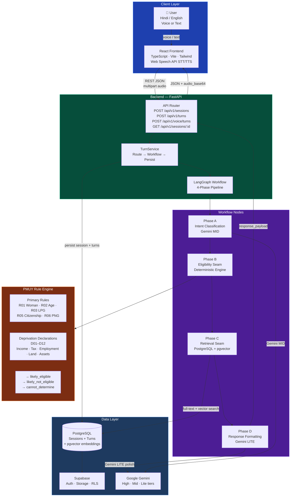
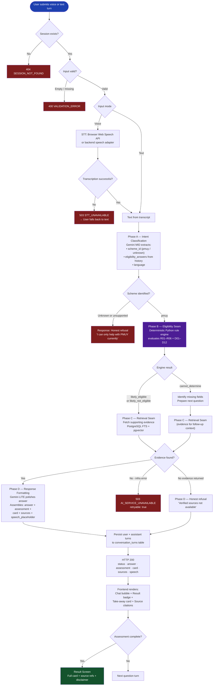
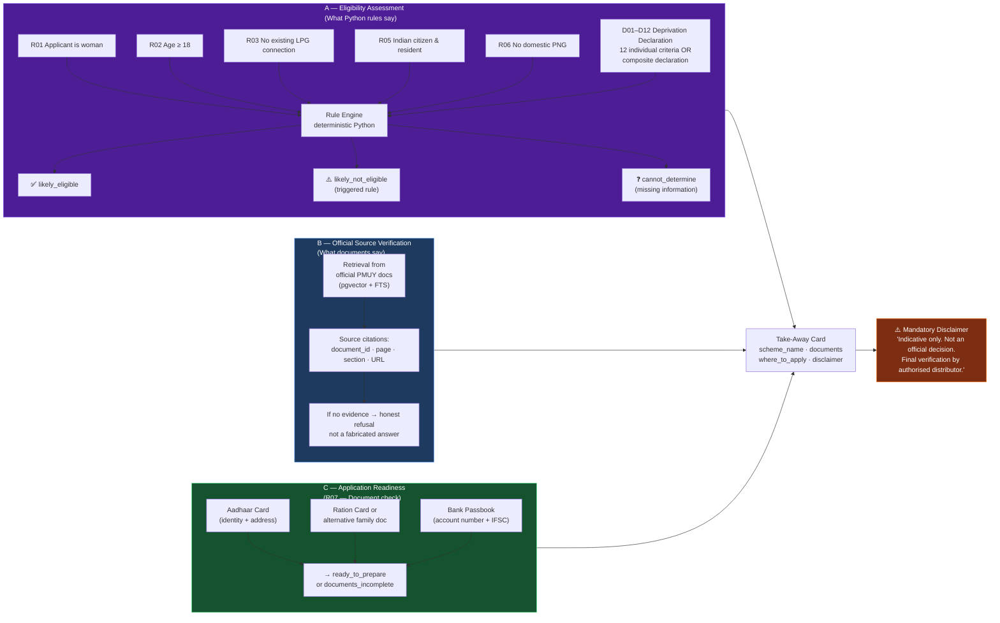
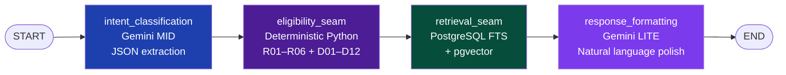
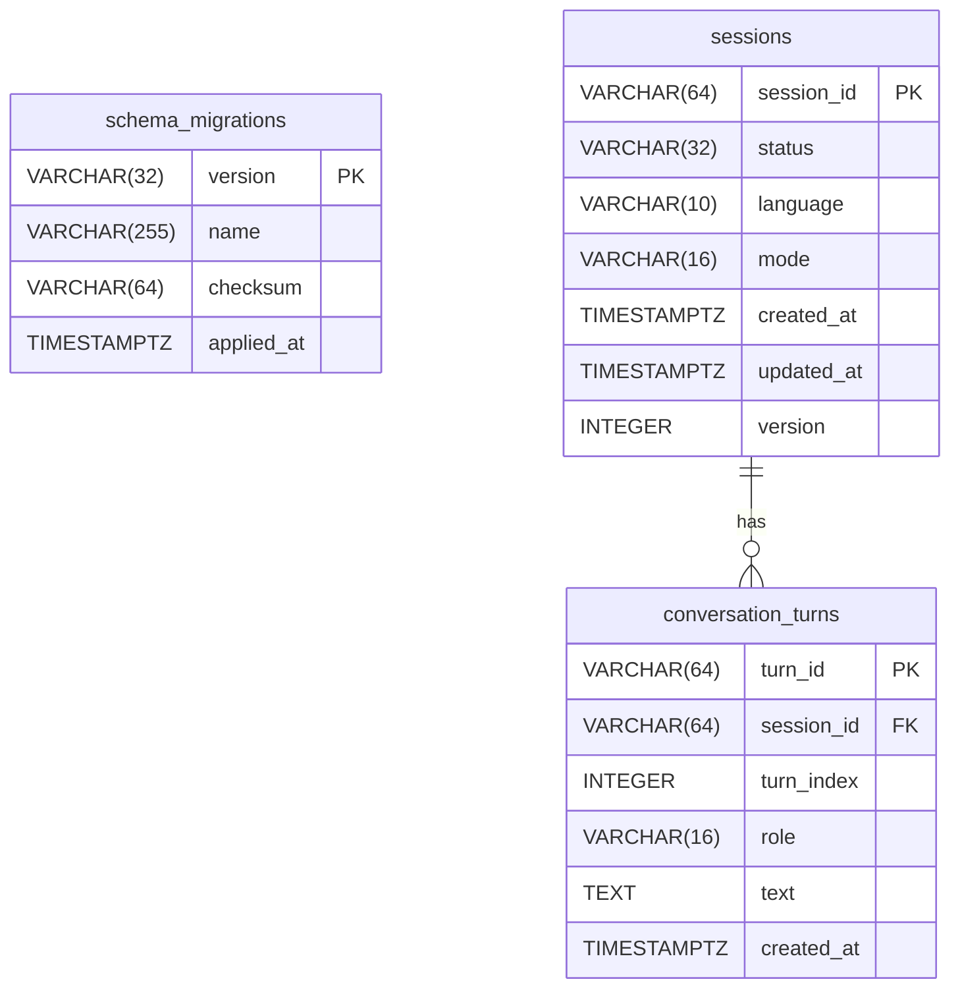

<div align="center">

# 🌾 Yojana Mitra

### Government schemes, explained in your language — by voice or text.

<p>
  An AI-powered, voice-first eligibility assistant that helps rural Indian families understand government schemes, discover whether they qualify, and leave with a clear action plan — in Hindi or English.
</p>

<p>
  
  
  
  
  
  
  
  
  
</p>

<p>
  Built by <strong>Team TRIVON</strong> · AI/ML Track · 24-hour hackathon, 30–31 October 2026
</p>

</div>

---

> **Core design principle:** *AI guides the conversation. Rules determine eligibility.*
>
> The LLM conducts the conversation and explains results. A deterministic Python rule engine exclusively decides eligibility. The model can never override a rule, and an unknown answer is never silently treated as "No."

---

## Table of Contents

- [The Problem](#the-problem)
- [Our Solution](#our-solution)
- [Key Features](#key-features)
- [System Architecture](#system-architecture)
- [End-to-End Workflow](#end-to-end-workflow)
- [Eligibility Decision Model](#eligibility-decision-model)
- [AI & Agent Workflow](#ai--agent-workflow)
- [Technology Stack](#technology-stack)
- [Project Structure](#project-structure)
- [Application Preview](#application-preview)
- [Getting Started](#getting-started)
- [API Documentation](#api-documentation)
- [Database & Data Flow](#database--data-flow)
- [Evaluation & Testing](#evaluation--testing)
- [Privacy, Security & Responsible AI](#privacy-security--responsible-ai)
- [Project Status](#project-status)
- [Team](#team)
- [Sources & Acknowledgements](#sources--acknowledgements)

---

## The Problem

Government schemes exist for the people who need them most — but reaching them is hard.

- **Information is scattered and technical.** Eligibility rules live in English or formal Hindi PDFs across multiple portals. The Pradhan Mantri Ujjwala Yojana (PMUY) deprivation declaration alone covers 13 criteria using terms like "irrigated land with irrigation equipment", "carpet area", and "Kisan Credit Card credit limit."
- **Rural India is online, and prefers speaking.** 488 million of India's 886 million internet users are rural (IAMAI-Kantar, 2024). Kisan Call Centres logged over 17 million calls in three years — clear evidence that people want spoken guidance.
- **A wrong answer is costly.** Without the right documents or a clear understanding of eligibility, families make repeat visits to offices and CSCs, pay intermediary fees, or miss benefits entirely.
- **Generic chatbots answer confidently without official sources.** When the source is missing, families cannot verify the answer or challenge an incorrect one.

Our focus is a **spoken, step-by-step eligibility conversation** that ends with a **concrete checklist** — built on rules that cannot be invented or overridden by an AI model.

---

## Our Solution

**Yojana Mitra** is a voice-first (and text) assistant for government scheme eligibility.

```
User → Choose language (Hindi or English)
     → Ask a question (voice or text)
     → Answer a few short questions
     → Receive: likely_eligible | likely_not_eligible | cannot_determine
     → Leave with: take-away card + documents + where to apply + official sources
```

> *Illustrative exchange (Hindi):*
> **User:** क्या मैं उज्ज्वला योजना के लिए पात्र हूँ?
> **Mitra:** क्या आपके घर में पहले से LPG कनेक्शन है?
> *...a few more short questions...*
> **Result card:** Likely eligible — carry Aadhaar, ration card, bank passbook — apply at nearest LPG distributor or CSC — confirm with distributor.

---

## Key Features

| Feature | What it does | Why it matters |
|---|---|---|
| 🗣️ **Bilingual voice & text** | Hindi (`hi-IN`) and English (`en-IN`); freely switch mid-session | Reaches users who cannot read formal documents |
| 🎙️ **Browser-native voice** | Web Speech API STT + Web Speech Synthesis TTS in the frontend | No app install required; works in Chrome/Edge on mobile |
| ⚖️ **Rules in code, not in the model** | Deterministic Python engine (R01–R06, D01–D12) decides eligibility | The LLM can never invent or override a rule; "not sure" stays "not sure" |
| ❓ **Unknown ≠ No** | Missing information produces `cannot_determine`, not ineligibility | Prevents false disqualification of incomplete answers |
| 🧾 **Take-away action card** | Scheme name, required documents, where to apply, official disclaimer | Users leave with something concrete they can act on |
| 📚 **Official-source grounding** | Retrieval returns cited source ID, page, section, and URL | Every factual claim is traceable; unsupported answers are refused |
| 🧭 **Three separate outputs** | Eligibility · Verification · Application Readiness — kept distinct | A missing document never looks like ineligibility |
| 🔄 **Persistent conversation** | PostgreSQL-backed sessions; conversation history recovers PMUY answers | Users can continue across disconnections |
| 🔒 **Privacy by design** | No Aadhaar/bank numbers collected; raw audio never persisted | Reduces data exposure; audio processed in-memory only |
| 🛡️ **Mock mode** | Full contract-compliant responses with zero provider calls | Safe testing, demos, and local development |

---

## System Architecture



---

## End-to-End Workflow



---

## Eligibility Decision Model



**Critical invariants:**
- An unknown answer (`null`) is **never** coerced to `False` or a passing condition.
- Gemini **cannot** override, correct, or supplement a rule evaluation.
- Missing information produces `cannot_determine` with an explicit list of missing fields.
- Application readiness (documents) is tracked **separately** from eligibility — a missing document does not mean ineligibility.

---

## AI & Agent Workflow

### What the LLM does

| Phase | Node | Model tier | Responsibility |
|---|---|---|---|
| A | `intent_classification` | Gemini MID | Extract scheme intent, parse eligibility answers from conversation history, detect language |
| D | `response_formatting` | Gemini LITE | Polish deterministic answer text into natural conversation; assemble final response payload |

**What the LLM does NOT do:** decide eligibility, cite unsupported facts, or generate data not present in retrieved evidence.

### What deterministic Python does

The `evaluate_pmuy_eligibility()` function in [`backend/app/eligibility/engine.py`](backend/app/eligibility/engine.py) evaluates:

- **5 primary rules** (R01 Woman, R02 Age ≥18, R03 No LPG, R05 Citizenship, R06 No PNG)
- **12 deprivation declaration criteria** (D01–D12: income, taxes, employment, land, assets, housing, vehicles)
- **Contradiction detection** (e.g., `applicant_age=16` contradicts `age_18_or_above=True`)
- **Special handling** (family split disputes, government-scheme housing exceptions)
- **Application readiness** (R07: ration card or alternative, bank account)

Each rule returns one of three states: `passed=True`, `triggered=True` (exclusion), or `passed=None` (missing — never coerced).

### How retrieval works

Phase C (`retrieval_seam_node`) fetches grounded evidence from official PMUY documents using:
- PostgreSQL full-text search (keyword matching)
- pgvector semantic similarity search

Every chunk carries `document_id`, `title`, `page`, `section`, and `source_url`. If retrieval returns no evidence, the system issues an explicit refusal — it does not fabricate citations.

> **Current status:** The retrieval adapter is a safe seam stub (returns `[]`) pending ingestion of official PMUY PDFs. The ingestion pipeline ([`backend/app/ingestion/`](backend/app/ingestion/)) is scaffolded; the orchestrator is blocked on SHA-256 verification of source files.

### How conversation state is maintained

- **Per-turn stateless execution:** The LangGraph workflow runs fresh on every turn. No stateful checkpointer is used.
- **History from PostgreSQL:** `TurnService` loads `conversation_turns` from the database and injects them as runtime config into the workflow.
- **11-key frozen state contract:** `YojanaWorkflowState` (defined in [`backend/app/graph/state.py`](backend/app/graph/state.py)) carries exactly 11 keys matching `shared/api-contract.md §4.7`. No additional keys may be added without contract revision.

### LangGraph pipeline



The pipeline is linear in Round 1. Conditional routing (based on eligibility outcome and evidence availability) is architecturally planned for subsequent rounds.

---

## Technology Stack

| Layer | Technology | Role |
|---|---|---|
| **Frontend** | [React 18](https://react.dev) + TypeScript | UI shell, screens, conversation state |
| | [Vite 5](https://vitejs.dev) | Build tool and dev server |
| | [Tailwind CSS 3](https://tailwindcss.com) | Styling |
| | Web Speech API (browser-native) | STT (SpeechRecognition) + TTS (SpeechSynthesis) |
| | Lucide React | Icons |
| **Backend** | [FastAPI 0.110+](https://fastapi.tiangolo.com) | REST API, request/response validation |
| | [Pydantic v2](https://docs.pydantic.dev) | Schemas, settings, data validation |
| | [Uvicorn](https://www.uvicorn.org) | ASGI server |
| | Python 3.11+ | Application runtime |
| **AI & Orchestration** | [LangGraph 0.2+](https://langchain-ai.github.io/langgraph/) | 4-phase stateless workflow pipeline |
| | [Google Gemini](https://ai.google.dev) (`google-genai` SDK) | MID tier: intent classification; LITE tier: response formatting |
| | Deterministic Python rules | PMUY eligibility engine — authoritative; LLM cannot override |
| **Database & Retrieval** | [Supabase](https://supabase.com) PostgreSQL | Session + conversation persistence; Row Level Security |
| | [psycopg3](https://www.psycopg.org/psycopg3/) (async) | Direct PostgreSQL access via `asyncpg`-style pool |
| | [pgvector](https://github.com/pgvector/pgvector) | Semantic similarity retrieval (planned; schema defined) |
| | PostgreSQL FTS | Keyword search on official scheme documents |
| **Document Ingestion** | [pypdf 4+](https://pypdf.readthedocs.io) | Extract text and page numbers from official PDFs |
| | Custom chunker (`PMUYChunker`) | Chunk + metadata generation for retrieval |
| **Speech Processing** | Web Speech API (frontend) | Browser-native STT/TTS — implemented |
| | `SpeechAdapter` (backend) | Seam boundary for server-side STT/TTS — pending provider selection |
| **Testing** | [pytest 8+](https://docs.pytest.org) + pytest-asyncio | 168+ tests across all layers |
| **Deployment** | [Vercel](https://vercel.com) | Frontend hosting (planned) |
| | [Render](https://render.com) | Backend hosting (planned) |
| | Supabase Cloud | Managed PostgreSQL (planned) |
| **Dev Tooling** | Git + GitHub | Version control |
| | `python-dotenv` / `pydantic-settings` | Environment variable management |

---

## Project Structure

```text
yojana-mitra/
│
├── frontend/                        # React + TypeScript client application
│   ├── src/
│   │   ├── screens/                 # Six screens: Language, Welcome, Demo, Mode, Chat/Voice, Result
│   │   ├── components/
│   │   │   ├── chat/                # ChatBubble, ChatInput, TypingIndicator
│   │   │   ├── assessment/          # TakeAwayCard (result card component)
│   │   │   ├── common/              # Button, Card primitives
│   │   │   └── layout/              # Header with language switcher
│   │   ├── mocks/                   # Mock sessions, turns, and result fixtures (labeled "MOCK / TEST DATA")
│   │   ├── services/                # apiClient, sessionService, turnService
│   │   ├── types/                   # TypeScript types matching API contract
│   │   └── utils/constants.ts       # API base URL, feature flags
│   ├── package.json                 # React 18, Vite 5, Tailwind CSS 3
│   └── vite.config.ts
│
├── backend/
│   ├── app/
│   │   ├── api/routes/              # sessions.py, turns.py, voice.py, health.py
│   │   ├── core/                    # config.py (settings), errors.py (error handlers)
│   │   ├── schemas/                 # session.py, turn.py, common.py, error.py (Pydantic models)
│   │   ├── services/                # session_service.py, turn_service.py, fixture_service.py
│   │   ├── graph/                   # LangGraph workflow
│   │   │   ├── state.py             # YojanaWorkflowState — frozen 11-key TypedDict
│   │   │   ├── workflow.py          # build_yojana_workflow() + run_turn_workflow()
│   │   │   └── nodes/               # intent_classification, eligibility_seam, retrieval_seam, response_formatting
│   │   ├── eligibility/             # PMUY deterministic rule engine
│   │   │   ├── engine.py            # evaluate_pmuy_eligibility() — main entry point
│   │   │   ├── rules.py             # check_r01..r06, check_d01..d12 — pure functions
│   │   │   ├── models.py            # PMUYAnswers, PMUYAssessmentResult, EligibilityResult
│   │   │   ├── normalizer.py        # Input normalization
│   │   │   └── question_bank.py     # Question definitions for the interview flow
│   │   ├── llm/                     # Centralized Gemini client
│   │   │   ├── client.py            # GeminiClient — 3-tier routing (HIGH / MID / LITE)
│   │   │   ├── models.py            # ModelTier enum
│   │   │   ├── exceptions.py        # LLMProviderError, LLMQuotaExceededError, etc.
│   │   │   └── prompts/             # intent_scheme.py, response_formatting.py
│   │   ├── adapters/                # Seam boundaries for external integrations
│   │   │   ├── eligibility.py       # H3 — pending rule engine handoff
│   │   │   ├── retrieval.py         # H4 — pending corpus ingestion
│   │   │   └── speech.py            # STT (raises STTUnavailableError) + TTS placeholder
│   │   ├── database/                # Database layer
│   │   │   ├── connection.py        # AsyncConnectionPool lifecycle
│   │   │   ├── migrations.py        # SQL migration runner
│   │   │   └── repositories/        # SessionRepository, TurnRepository
│   │   └── ingestion/               # Document ingestion pipeline (scaffolded)
│   │       ├── extractor.py         # PMUYExtractor (pypdf)
│   │       ├── chunker.py           # PMUYChunker
│   │       └── ingest_pmuy.py       # Orchestrator (stub — blocked on source verification)
│   │
│   ├── migrations/
│   │   └── 001_create_core_persistence.sql  # schema_migrations, sessions, conversation_turns
│   ├── tests/                       # 168+ automated tests
│   └── requirements.txt
│
├── data/
│   ├── schemes/pmuy/
│   │   ├── questions.json           # Interview question definitions
│   │   └── source_manifest.json     # Official PMUY source documents with SHA-256 checksums
│   └── evaluation/
│       ├── eligibility_cases.jsonl  # 22 test cases: T01–T12 + EXT-01–EXT-10
│       ├── question_flow_scenarios.jsonl
│       └── run_eligibility_scorecard.py
│
├── shared/
│   ├── api-contract.md              # Frozen Phase 3.3 API contract (authoritative)
│   └── examples/                   # Canonical JSON response fixtures
│
├── docs/
│   ├── DECISIONS.md                 # Frozen Phase 4.1 architectural decisions D1–D14
│   ├── research/PMUY/               # Official PMUY research, Knowledge Base, test definitions
│   └── images/                      # Screenshots (3 UI screenshots + UX poster)
│
├── .env.example                     # Variable names only — never real secrets
├── AGENTS.md                        # Repository governance and agent rules
└── README.md
```

---

## Application Preview

The project includes screenshots captured during the hackathon build.

<table>
  <tr>
    <td align="center"></td>
    <td align="center"></td>
    <td align="center"></td>
  </tr>
</table>

<p align="center">
  
  <br><em>UX flow documentation poster</em>
</p>

> **Recommended additional screenshots** (not yet captured): live voice mode orb with pulsing animation; Result Screen with a completed take-away card and source citations; the Hindi and English result badge side-by-side.

---

## Getting Started

### Prerequisites

- **Node.js** LTS (for frontend)
- **Python 3.11+** (for backend)
- **A Supabase project** with a PostgreSQL database (for persistent mode)
- **A Google Gemini API key** (for AI features)

> Run the backend with `MOCK_MODE=true` to skip all provider credentials and use pre-built fixtures. The mock API produces responses in the same schema as the real API, clearly labeled "MOCK / TEST DATA."

### 1. Clone the repository

```bash
git clone https://github.com/ankush_poonia007/yojana-mitra.git
cd yojana-mitra
```

### 2. Backend setup

**Windows (PowerShell):**
```powershell
cd backend
python -m venv .venv
.\.venv\Scripts\Activate.ps1
pip install -r requirements.txt
```

**macOS / Linux (bash):**
```bash
cd backend
python -m venv .venv
source .venv/bin/activate
pip install -r requirements.txt
```

**Configure environment:**
```bash
cd ..                       # back to repo root
cp .env.example .env        # copy variable names
# Edit .env and fill in:
#   GEMINI_API_KEY, SUPABASE_URL, SUPABASE_ANON_KEY,
#   SUPABASE_SERVICE_ROLE_KEY, DATABASE_URL
# For local mock testing, set:
#   MOCK_MODE=true
```

**Run the database migration** *(skip if using mock mode)*:
```bash
# Connect to your Supabase PostgreSQL and run:
# backend/migrations/001_create_core_persistence.sql
```

**Start the backend:**
```bash
cd backend
uvicorn app.main:app --reload
# API docs: http://localhost:8000/docs
# Health:   http://localhost:8000/health
```

### 3. Frontend setup

```bash
cd frontend
npm install
```

**Configure frontend environment:**
```bash
cp .env.example .env
# Set VITE_API_BASE_URL=http://localhost:8000
# Set VITE_MOCK_MODE=true for fully offline demo
```

**Start the frontend:**
```bash
npm run dev
# App: http://localhost:5173
```

### 4. Run tests

```bash
cd backend
.\.venv\Scripts\python.exe -m pytest -q      # Windows
# or
python -m pytest -q                           # macOS/Linux
```

### Troubleshooting

| Error | Likely cause | Fix |
|---|---|---|
| `npm error ENOENT: package.json` | Running `npm` from project root | `cd frontend` first |
| `LLMConfigurationError: GEMINI_API_KEY not configured` | Missing key | Set `GEMINI_API_KEY` in `.env`, or set `MOCK_MODE=true` |
| `DATABASE_URL not set` in persistent mode | Missing DB URL | Set `DATABASE_URL` in `.env`, or set `MOCK_MODE=true` |
| `STTUnavailableError` | Backend STT not wired | Use browser voice mode (frontend) or text mode |
| 13 pytest warnings about `asyncio_default_fixture_loop_scope` | pytest-asyncio deprecation | Non-blocking; all tests pass |

---

## API Documentation

Base path: `/api/v1`. All errors use the frozen error envelope.

**Error envelope (all errors):**
```json
{
  "error": {
    "code": "ERROR_CODE",
    "message": "Human-readable description.",
    "retryable": false,
    "details": {}
  }
}
```

### `POST /api/v1/sessions` — Create session

```json
// Request
{ "language": "hi", "mode": "voice" }

// Response 201
{
  "session_id": "sess_abc123",
  "status": "active",
  "language": "hi",
  "mode": "voice",
  "created_at": "2026-10-31T07:30:00Z"
}
```

**Error codes:** `INVALID_SESSION_INPUT` (422)

---

### `GET /api/v1/sessions/{session_id}` — Retrieve session

Returns session metadata and conversation turn history.

**Error codes:** `SESSION_NOT_FOUND` (404)

---

### `POST /api/v1/turns` — Submit text turn

```json
// Request
{ "session_id": "sess_abc123", "text": "क्या मैं उज्ज्वला योजना के लिए पात्र हूँ?" }

// Response 200
{
  "session_id": "sess_abc123",
  "turn_id": "turn_001",
  "status": "awaiting_information",
  "language": "hi",
  "answer": { "text": "क्या आपके घर में पहले से LPG कनेक्शन है?" },
  "assessment": null,
  "card": null,
  "sources": [],
  "speech": { "status": "generated", "content_type": "audio/mpeg", "audio_base64": "DEMO_AUDIO_DATA" }
}
```

**Completed assessment response** (`status: "completed"`):
```json
{
  "assessment": {
    "scheme_id": "pmuy",
    "result": "likely_eligible",
    "reasons": ["Applicant is an adult woman (18+).", "Household has no existing LPG connection."],
    "missing_information": []
  },
  "card": {
    "scheme_name": "Pradhan Mantri Ujjwala Yojana",
    "documents": ["Aadhaar Card", "Ration Card or family composition proof", "Bank Passbook"],
    "where_to_apply": ["Nearest LPG Distributor", "Common Service Centre (CSC)"],
    "disclaimer": "Indicative eligibility only, not an official government approval."
  },
  "sources": [{ "document_id": "pmuy_official_001", "title": "PMUY Official Guidelines", "url": "...", "page": 4 }]
}
```

**Error codes:** `EMPTY_INPUT` (400), `SESSION_NOT_FOUND` (404), `AI_SERVICE_UNAVAILABLE` (503, retryable)

---

### `POST /api/v1/voice/turns` — Submit voice turn

**Content-Type:** `multipart/form-data`

| Field | Type | Required |
|---|---|---|
| `session_id` | string | Yes |
| `audio` | file | Yes |
| `language` | string | No (defaults to session language) |

Response adds a `transcription` field:
```json
{ "transcription": { "text": "मेरे घर में पहले से गैस कनेक्शन नहीं है।", "confidence": null } }
```

**Error codes:** `EMPTY_AUDIO` (400), `INVALID_LANGUAGE` (422), `SESSION_NOT_FOUND` (404), `STT_UNAVAILABLE` (503, retryable)

---

### `GET /health` — Health check

```json
{ "status": "ok" }
```

---

## Database & Data Flow

### Schema (migration `001`)



**Design constraints:**
- `role` is constrained to `user` or `assistant`
- `language` is constrained to `hi` or `en`
- No `ON DELETE CASCADE` — turns survive session status changes
- No raw audio stored; no PII (no Aadhaar, no bank numbers)
- Optimistic concurrency via `version` column on sessions

### Data flow for a turn

```
HTTP Request → TurnService
  → Load session from SessionRepository (404 if missing)
  → Load conversation_turns history from TurnRepository
  → Inject history into LangGraph workflow as runtime config
  → run_turn_workflow(initial_state, history)
  → Phase A: Gemini extracts eligibility_answers from history + new turn
  → Phase B: Deterministic engine evaluates PMUY rules
  → Phase C: Retrieval seam fetches grounded evidence
  → Phase D: Gemini LITE polishes response
  → TurnService.append_turn_pair(): persist user + assistant turns atomically
  → Return response_payload to API router
```

---

## Evaluation & Testing

### Test suite

The backend includes **368 automated tests** (as of hackathon build) across 14 test modules:

| Module | Tests | Coverage |
|---|---|---|
| `test_eligibility.py` | 40+ | All 12 official PMUY cases (T01–T12) + 10 extended invariant cases (EXT-01–EXT-10) |
| `test_graph.py` | 17 | LangGraph pipeline, adapter seams, workflow integration |
| `test_llm.py` | 11 | GeminiClient unit tests; 3-tier model resolution |
| `test_service_persistence.py` | 24 | Session + turn service in mock and persistent modes |
| `test_database.py` | 15 | Pool lifecycle, credential scrubbing, mock startup |
| `test_repositories.py` | 12 | SessionRepository + TurnRepository CRUD |
| `test_migrations.py` | 14 | DDL loading, migration runner, version tracking |
| `test_sessions.py` | 8 | Session creation and retrieval via API |
| `test_turns.py` | 5 | Text turn submission and validation |
| `test_voice.py` | 5 | Voice turn multipart submission |
| `test_normalizer.py` | — | Input normalization for eligibility answers |
| `test_question_bank.py` | — | Question bank definitions |
| `test_config.py` | 5 | Settings and environment variable loading |
| `test_errors.py` | 4 | Error envelope structure |

**Run all tests:**
```bash
cd backend
python -m pytest -q
# Expected: 168+ passed
```

### PMUY eligibility evaluation cases

22 defined test cases in [`data/evaluation/eligibility_cases.jsonl`](data/evaluation/eligibility_cases.jsonl):

| Case ID | Scenario | Expected result |
|---|---|---|
| T01 | Positive eligible — adult woman, all criteria pass | `likely_eligible` |
| T02 | Underage applicant (age 17) | `likely_not_eligible` (R02) |
| T03 | Male applicant | `likely_not_eligible` (R01) |
| T04 | Existing LPG connection | `likely_not_eligible` (R03) |
| T05 | Domestic PNG connection | `likely_not_eligible` (R06) |
| T06–T07 | Income/tax payer in household | `likely_not_eligible` (D01/D03) |
| T08 | House >30 sqm from government scheme (exception) | `likely_eligible` |
| T09 | KCC credit limit unknown | `cannot_determine` (D06) |
| T11 | Family split dispute with LPG record linkage | `cannot_determine` |
| T12 | Biometric pending — does not affect eligibility | `likely_eligible` |
| EXT-01 | All 12 deprivation criteria unanswered | `cannot_determine` (`poor_household_declaration` missing) |
| EXT-05 | Unknown LPG status — must not coerce to eligible | `cannot_determine` |
| EXT-06 | Age contradiction (`applicant_age=16` vs `age_18_or_above=True`) | `cannot_determine` |

**Key safety invariant tested:** `null` inputs are **never** coerced to `False` (Decision D3). A single triggered exclusion rule disqualifies regardless of unknown status of other fields.

### Evaluation pending

- **Retrieval scorecard:** accuracy of source citations and honest refusals — pending corpus ingestion
- **STT/TTS benchmark:** Hindi accuracy on noisy rural recordings — pending provider selection
- **End-to-end conversation evaluation:** full session flow from voice input to result card
- **Measured latency:** per-turn response time — not yet measured

> No accuracy percentages, latency numbers, or benchmark scores are claimed. All figures above reflect test case design, not measured evaluation results.

---

## Privacy, Security & Responsible AI

### Implemented safeguards

| Area | Safeguard |
|---|---|
| **No PII collection** | Aadhaar numbers, bank account numbers, and biometric credentials are never requested or accepted |
| **Audio not persisted** | Raw audio is processed in-memory only by the backend; never written to disk or database |
| **Server-side secrets** | `GEMINI_API_KEY`, `SUPABASE_SERVICE_ROLE_KEY` never sent to frontend; never committed to git |
| **Credential scrubbing** | Database error messages are sanitized before logging to prevent credential leaks (tested) |
| **Input validation** | Pydantic v2 validates all request inputs; empty text/audio returns 400 before workflow runs |
| **Error envelope** | All errors use the frozen envelope; no stack traces or internal details in responses |
| **Mock/real separation** | Mock responses are clearly labeled "MOCK / TEST DATA" in the UI; never presented as real evidence |
| **Indicative disclaimer** | Every result screen shows a mandatory disclaimer that the result is not an official government decision |

### Responsible AI principles

- **LLM cannot decide eligibility.** The Python rule engine is the sole authority.
- **Honest refusals.** When retrieved evidence is absent, the assistant says so — it does not fabricate a citation.
- **`cannot_determine` is a first-class result.** Incomplete information never defaults to ineligibility.
- **No impersonation.** Yojana Mitra does not claim to be a government service.

### Known limitations

- The reviewed PMUY deprivation declaration PDF does not show a visible revision date. All thresholds must be re-confirmed with an authorised distributor or OMC before any public use.
- `speech.status` in the response always reads `"generated"` even when TTS is unavailable (placeholder mode). This matches the frozen contract shape but is semantically imprecise — tracked as an open item pending Ankush–Aditya contract agreement.
- Live PostgreSQL acceptance is pending network connectivity to Supabase. All persistence tests run against mock/stub connections.

---

## Project Status

| Area | Status | Notes |
|---|---|---|
| Problem research & solution design | ✅ Complete | |
| PMUY official-source research | ✅ Complete | One open verification: deprivation declaration revision date |
| Architecture & API contract | ✅ Frozen | `shared/api-contract.md`, `AGENTS.md` |
| Database schema & migrations | ✅ Complete | `001_create_core_persistence.sql`; live PostgreSQL acceptance pending |
| PMUY deterministic rule engine | ✅ Complete | R01–R06 + D01–D12; 22 test cases defined; tested |
| LangGraph 4-phase workflow | ✅ Complete | Compiles; runs; all edges wired; 17 tests passing |
| Centralized Gemini client | ✅ Complete | 3-tier routing; timeout; JSON sanitization; 11 tests passing |
| Session + turn persistence | ✅ Complete | Repository + service + 24 tests; live DB pending |
| Frontend screens (all 6) | ✅ Complete | Language, Welcome, Demo, Mode Select, Chat/Voice, Result |
| Browser-native voice (frontend) | ✅ Complete | Web Speech API STT + TTS; real working implementation |
| Response formatting (Gemini LITE) | ✅ Complete | Bilingual; deterministic fallback when Gemini unavailable |
| Eligibility adapter seam (H3) | ⚠️ Partial | Safe stub (`cannot_determine`); full engine pending integration |
| Retrieval adapter seam (H4) | ⚠️ Partial | Safe stub (returns `[]`); corpus ingestion pending |
| Backend speech adapter (server-side) | ⚠️ Partial | STT raises `STTUnavailableError`; TTS returns `DEMO_AUDIO_DATA` |
| Document ingestion pipeline | 🔨 Scaffolded | Extractor + chunker built; orchestrator blocked on source verification |
| Frontend ↔ backend API integration | 🔨 In progress | Services scaffolded; chat screen uses deterministic mock replies |
| Deployment (Vercel + Render + Supabase) | ⬜ Planned | |
| Measured evaluation scorecard | ⬜ Planned | |
| PM-KISAN and PM-JAY 70+ schemes | ⬜ Planned | Information-only in v1 |

---

## Team

**TRIVON**

| Member | Role | Ownership |
|---|---|---|
| **Ankush Poonia** | Team Lead · Backend Orchestration & Integration | `backend/` (routes, workflow, graph, LLM, services, database), `shared/`, root config, integration docs |
| **Anamika** | Data, Research, Rules & Speech | `data/`, `docs/research/PMUY/`, eligibility engine, STT/TTS benchmarking |
| **Aditya** | Frontend & Client Experience | `frontend/` (React app, TypeScript types, UI/UX, audio playback, demo materials) |

---

## Sources & Acknowledgements

### Official PMUY sources
- [New Ujjwala 2.0 Connection — pmuy.gov.in](https://www.pmuy.gov.in/ujjwala2.html)
- [PMUY FAQs — pmuy.gov.in](https://www.pmuy.gov.in/faq.html)
- [Deprivation Declaration for Poor Households (PDF)](https://www.pmuy.gov.in/documents/Deprivation_Declaration_for_Poor_Households_English.pdf)
- [PMUY KYC Application (PDF)](https://pmuy.gov.in/documents/Ujjwala-KYC_englishnew.pdf)

### Research references
- IAMAI-Kantar, *Internet in India Report 2024*, via [Storyboard18](https://www.storyboard18.com/amp/digital/surge-in-indic-language-adoption-leads-to-55-surge-in-rural-internet-users-53632.htm)
- Kisan Call Centre volumes, government statement, August 2021, via [Krishak Jagat](https://www.en.krishakjagat.org/?p=8671)
- [myScheme — National Scheme Discovery Platform](https://www.myscheme.gov.in/)

### Technical libraries
- [LangGraph](https://langchain-ai.github.io/langgraph/) — Google DeepMind / LangChain
- [Google GenAI Python SDK](https://github.com/google-gemini/generative-ai-python)
- [FastAPI](https://fastapi.tiangolo.com) — Sebastián Ramírez
- [Supabase](https://supabase.com)
- [pgvector](https://github.com/pgvector/pgvector)

---

## Contributing

This repository was built during a 24-hour hackathon. Contribution guidelines will be added after the initial release. Please respect the ownership boundaries defined in [`AGENTS.md`](AGENTS.md) when opening pull requests.

## License

License not yet assigned. All rights reserved pending team decision.

---

<div align="center">

**⚠️ Disclaimer**

Yojana Mitra is an independent citizen assistance initiative and is **not** an official government service.
It does not submit applications, does not approve or deny any benefit, and does not access government databases.
All eligibility results are **indicative only**. Final verification and approval rests entirely with the competent authority or authorised distributor.

</div>
